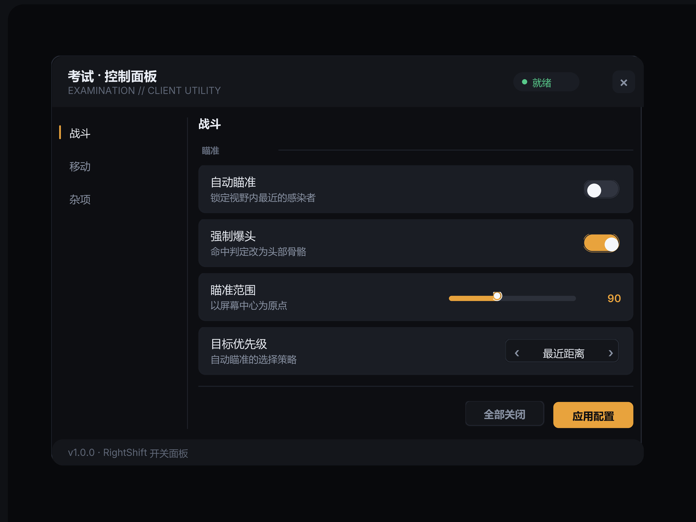

# CDMUI



Roblox / Luau 单文件控制面板 UI 库。零依赖，`loadstring` 直载。

- **控件齐全** — Toggle / Slider / Cycle / Input / Keybind / MultiSelect / Expand / Label / Divider / Buttons
- **统一视觉** — 全库共用一套色阶与尺寸规范（`T` 主题表 + `SIZE` 尺寸表），改一处全局生效
- **完整动效** — 面板进出场、Tab 收起展开、子项逐行撑开、勾选框缩放弹出、循环按钮滑动、按钮按压回弹
- **PC / 移动端自适应** — `LAYOUT` 表统一管理两套尺寸，移动端放大点击区域、Tab 平分整行、支持拖动面板
- **无头预览** — 配套 [Roblox-Ui-Expert-Skill](https://github.com/WasKKal/Roblox-Ui-Expert-Skill)，不进 Studio 就能渲染 PNG / 可交互 HTML / APNG

## 快速开始

```lua
local UI = loadstring(game:HttpGet("https://raw.githubusercontent.com/WasKKal/CDMUI/main/CDMUI.lua"))()

local win = UI.Create({ Title = "控制面板" })
local tab = win:Tab("战斗")

tab:Toggle({
    Key = "aimbot",
    Title = "自动瞄准",
    Desc = "锁定视野内最近的敌人",
    Default = true,
    Callback = function(v) print("aimbot", v) end,
})

tab:Slider({
    Key = "fov",
    Title = "瞄准范围",
    Min = 30, Max = 180, Step = 5, Default = 90,
})

tab:Expand({
    Key = "esp",
    Title = "敌人透视",
    Desc = "高亮全场感染者",
    Children = {
        { Kind = "toggle", Key = "espName",  Title = "显示名称", Default = true },
        { Kind = "toggle", Key = "espHP",    Title = "显示血量" },
        { Kind = "number", Key = "espRange", Title = "显示距离", Min = 50, Max = 500, Default = 200 },
    },
})
```

## API

### `UI.Create(opts)`

| 字段 | 类型 | 默认 | 说明 |
|---|---|---|---|
| `Title` | string | `"控制面板"` | 顶部大标题 |
| `GuiName` | string | `"ControlPanelUI"` | ScreenGui 名称 |
| `DisplayOrder` | number | `101` | 显示层级 |
| `AutoOpen` | bool | `true` | 创建后是否直接显示 |
| `TopbarButton` | bool | `true` | 是否创建左上角顶栏按钮 |
| `TopbarText` | string | `"控制面板"` | 顶栏按钮文字 |
| `ToggleKey` | Enum.KeyCode | `nil` | 快捷键（建议不设，避免与游戏按键冲突） |

返回 `Window`。

### Window

| 方法 | 说明 |
|---|---|
| `win:Tab(name)` | 新建 Tab，返回 `Tab` |
| `win:SelectTab(index, instant)` | 切换 Tab（带收起/展开动画） |
| `win:SetVisible(bool, instant)` | 显示 / 隐藏面板 |
| `win:Toggle()` | 翻转可见性 |
| `win:Notify(text, duration)` | 弹入通知 |
| `win:Get(key)` / `win:Set(key, value)` | 读写控件状态 |
| `win:Destroy()` | 销毁并断开所有连接 |

### Tab

| 方法 | 说明 |
|---|---|
| `tab:Toggle(cfg)` | 开关 |
| `tab:Slider(cfg)` | 滑动条（`Min` / `Max` / `Step` / `Default`） |
| `tab:Cycle(cfg)` | 左右切换选择（`Options` / `DefaultIndex`） |
| `tab:Input(cfg)` | 数字输入框（支持 `Quick` 快捷值） |
| `tab:Keybind(cfg)` | 按键绑定 |
| `tab:MultiSelect(cfg)` | 多选 chips（`Options` / `Default`） |
| `tab:Expand(cfg)` | 可展开分组（`Children` 子项） |
| `tab:Label(cfg)` | 说明文字行 |
| `tab:Divider()` | 分隔线 |
| `tab:Buttons(cfg)` | 按钮行（`Buttons = { { Text, Variant, Width, Callback } }`） |

控件通用字段：`Key`（状态键）、`Title`、`Desc`、`Default`、`Callback`。
用 `win:Set(key, v)` / `win:Get(key)` 按 `Key` 寻址。

### Expand 子项

```lua
Children = {
    { Kind = "toggle", Key = "...", Title = "...", Default = true },
    { Kind = "number", Key = "...", Title = "...", Min = 1, Max = 20, Default = 4 },
    { Kind = "cycle",  Key = "...", Title = "...", Options = { "A", "B" } },
}
```

### 按钮变体

| Variant | 外观 | 用途 |
|---|---|---|
| `primary` | 白底黑字 | 主操作 |
| `secondary` | 深灰底 + 描边 | 常规操作（默认） |
| `danger` | 暗红底 + 红字 | 危险操作 |
| `ghost` | 极淡底 | 次要操作 |

## 设计规范

全库只有三档明度 + 一个强调色：

```
背景  15,15,18     行  25,25,30     子行  21,21,26
控件  38,38,45     悬停 50,50,58
文字  240,240,245 / 220,220,225 / 130,130,140
强调  255,255,255（Tab 选中 / 勾选框 / 滑动条）
```

尺寸规范集中在 `SIZE` 表：控件圆角 `6`、行圆角 `4`、控件标准高 `28`、勾选框 `28 / 22`、展开箭头 `34`。

PC / 移动端尺寸集中在 `LAYOUT` 表，判断方式与 Roblox 官方一致：

```lua
local IS_TOUCH = UserInputService.TouchEnabled
local IS_MOBILE = IS_TOUCH and not UserInputService.KeyboardEnabled
```

| 项 | PC | 移动端 |
|---|---|---|
| 面板 | 460×580 | 560×620 |
| 行高 | 58 | 72 |
| Tab | 88 宽 | 平分整行 |
| 勾选框 | 28 | 32 |
| 控件字号 | 12 | 14 |

## 无头预览

```powershell
tools\ui.cmd -Action image `
  -Lib "CDMUI.lua=<repo>\CDMUI.lua,demo.lua=<repo>\examples\demo.lua" `
  -Scenario <repo>\examples\demo_scenario.lua `
  -Out out\cdmui.png
```

| 文件 | 内容 |
|---|---|
| `examples/demo.lua` | 四页完整示例 |
| `examples/demo_scenario.lua` | 布局 + Tab 切换 + 控件点击断言 |
| `examples/demo_tabs_scenario.lua` | Slider / Keybind / MultiSelect 断言 |
| `examples/demo_anim_scenario.lua` | 进出场动画采样 |

## 许可

MIT
